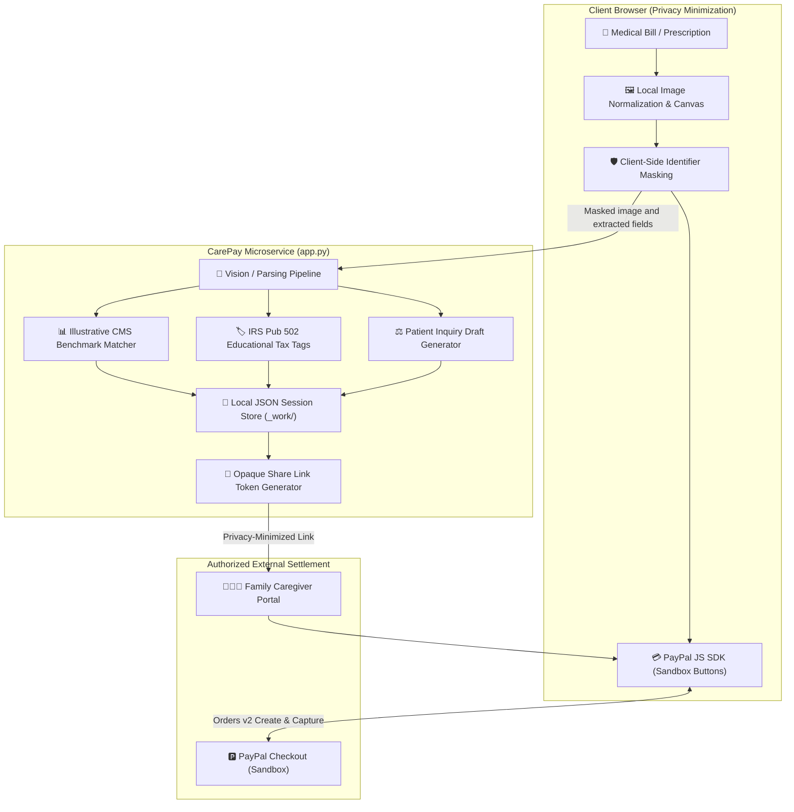
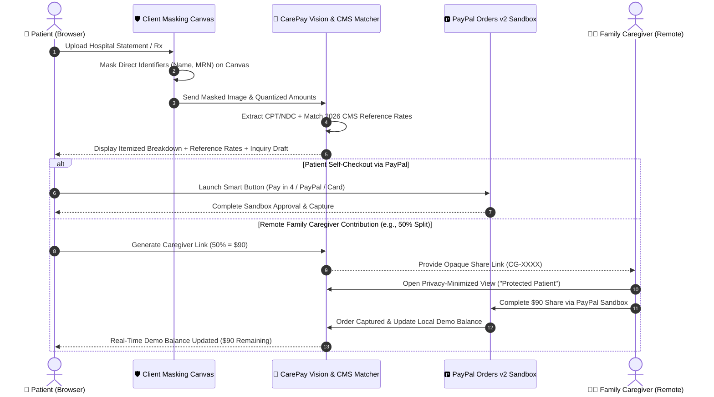

# 🛡️ PainFree CarePay AI
> **Medical Bill Review Intelligence with PayPal Sandbox Checkout & Family Caregiver Sharing**  
> *Hackathon Prototype for the PayPal AI Hackathon 2026*  
> 📺 **Demo Video**: [Watch Demo Walkthrough on YouTube (2m 18s)](https://youtu.be/26lQsW1gghE)

---

## 📋 Executive Summary
In the United States, over **100 million Americans struggle with medical debt**, burdened by opaque hospital billing, unexpected charges, and dense CPT/NDC medical codes. Furthermore, over **53 million family caregivers** coordinate care for aging parents but lack a straightforward, privacy-conscious way to review bills and contribute payments remotely.

**PainFree CarePay AI** bridges medical bill comprehension directly with **PayPal's payment ecosystem**:
1. **Itemize & Review**: Patients upload hospital bills or pharmacy receipts to extract itemized CPT codes and billed amounts.
2. **Reference Comparison**: Compares charges against illustrative CMS reference benchmarks and drafts patient communication questions for hospital billing departments.
3. **Sandbox Checkout Flow**: Patients can view an illustrative 4-installment breakdown or dispatch an **Opaque Caregiver Share Link** so family members can review minimized bill summaries and test contributing a portion via PayPal Sandbox.

---

## 💡 Why This Matters for PayPal (Strategic Business Value)
The US out-of-pocket healthcare market exceeds **$490 Billion annually**, yet medical billing remains one of the last major sectors dominated by paper bills and disjointed hospital portals:

1. **Healthcare BNPL & Pay Later Potential**: Explores how unexpected medical expenses ($30–$1,500) can be presented to consumers with transparent installment illustrations, demonstrating how PayPal Pay in 4 could be introduced into medical payment workflows.
2. **Multi-User Family Checkout**: Caregiver share links introduce a collaborative payment dynamic, enabling adult children and family members to contribute toward shared healthcare expenses through the PayPal checkout flow.
3. **Pre-Checkout Clarity**: By helping patients understand itemized line items and reference benchmarks before paying, CarePay promotes informed checkout decisions and transparency.

---

## 🔒 Privacy-Minimized Client Prototype & Architecture

The prototype demonstrates **client-side masking of selected direct identifiers** (such as patient names) on the client canvas before transmission. Masking in this prototype may not remove all personal or health information; reviewers should use the included verified sample data for evaluation. This demonstration is an exploration of client-side privacy minimization and is not a formal determination of de-identification or HIPAA compliance.



### End-to-End Workflow


---

## 🚀 Key Features Demonstrated in the Prototype

### 1. Vision AI Medical Bill Deconstruction & CMS Benchmarks
- **Multimodal Bill Parsing**: Deconstructs tabular statements into procedure codes (CPT), drug codes (NDC), descriptions, and billed charges.
- **2026 CMS Medicare Reference Comparison**: Compares charges against national CMS Medicare allowable reference benchmarks (e.g., CPT 96372 billed at $90.00 vs $24.80 CMS reference rate) to highlight items worthy of review.
- **Patient Inquiry Communication Draft**: Automatically generates draft inquiry letters referencing consumer protection concepts (such as 45 CFR § 149.410 No Surprises Act and hospital financial assistance policies) to help patients ask informed questions.
- **IRS Pub 502 Educational Categorization**: Provides informational classification under IRC § 213(d) guidelines for HSA/FSA eligible health expenses.

### 2. PayPal Sandbox Checkout & Pay in 4 Illustration
- **Pay in 4 Installment Illustration**: Dynamically calculates and displays an estimated 4-payment bi-weekly schedule for qualifying balances between $30.00 and $1,500.00 (e.g., $180.00 balance displayed as 4 payments of $45.00).
- **Official PayPal Smart Payment Buttons**: Direct integration with PayPal JS SDK (`locale=en_US`, `enable-funding=paylater,venmo`) supporting the Orders v2 lifecycle (`createOrder` and `onApprove` capture) across PayPal, Pay Later, and Venmo Sandbox.
- **Transparent Consumer Notice**: Clearly advises patients: *"Estimated installment illustration. Eligibility, funding sources, and final terms are determined by PayPal at checkout."*

### 3. Family Caregiver Payment Portal (Privacy-Minimized)
- **Opaque Tokenized Share Links**: Generates unique, non-guessable tokens (`CG-XXXX`) allowing family members to view and contribute to a designated bill.
- **Privacy-Conscious Presentation**: Hides personal patient names (masked to `Protected Patient (Privacy-Minimized View)`) and presents masked clinical item codes (`PRIV-MASK-01`) to minimize sensitive disclosure.
- **Collaborative Family Care Ledger**: Allows patients to set 25%, 50%, 75%, or 100% contribution requests, tracking cumulative family contributions and remaining demo balances in real time as partial payments are captured.

---

## ⚖️ Important Limits & Disclaimers
- **Educational & Reference Scope**: CMS reference data used in the sample is for illustrative comparison only. It does not constitute a legal determination of overcharging, nor does it represent contracted private insurance rates or patient co-pay responsibility.
- **Not Legal, Tax, or Medical Advice**: All generated inquiry drafts, tax tags, and coding notes are educational prompts for patient review. Users should consult their healthcare provider, insurer, or qualified tax advisor.
- **Sandbox Simulation vs. Real Settlement**: The prototype demonstrates payment interactions exclusively within the PayPal Sandbox. Any balance shown in the UI is a local demonstration balance and does not represent an actual payment to a healthcare provider or an adjustment to a real medical account.
- **Financing Eligibility**: PayPal independently determines buyer eligibility for Pay Later, Pay in 4, and other payment methods during checkout.
- **Prototype Status**: This prototype demonstrates client-side data minimization principles for demonstration purposes. Production healthcare deployment would require formal HIPAA assessments, appropriate security safeguards, and business associate agreements (BAAs) where required.

---

## 🛠️ Tech Stack & Technical Architecture
- **Frontend**: Vanilla HTML5 / CSS3 / JavaScript (Lightweight responsive UI).
  - *DOM Construction*: Uses native element construction (`textContent`) to avoid raw HTML injection from OCR transcripts.
  - *PayPal JS SDK*: Smart Payment Buttons integration configured for the PayPal Sandbox Orders v2 lifecycle.
- **Backend**: Python 3.10 standard library `http.server.ThreadingHTTPServer` microservice (`app.py`), JSON REST API.
  - *Request Handling*: Threaded request handling for bill parsing and local demo state updates.
  - *File Validation*: 12MB payload limit, canonicalized path resolution, and isolated in-memory processing.
  - *Local Persistence*: Atomic file replacement (`os.replace`) to local JSON storage (`_work/invoices_store.json`, `_work/caregiver_tokens.json`) to persist demo session state across server restarts.
- **AI Vision Pipeline**: Multimodal fallback architecture (`receipt_pipeline.py`) supporting local mock presets and live vision inference.
- **Payments**: PayPal Developer Sandbox, Smart Payment Buttons, Orders v2 API (`/v2/checkout/orders`).

---

## 🔮 Future Vision & Roadmap
While the current prototype focuses on bill review and PayPal Sandbox checkout, future production exploration may include:
- **PayPal Pay Monthly & Venmo Integrations**: Expanding beyond Pay in 4 to explore longer-term financing options for high-balance bills and native Venmo collaborative family settlement.
- **HSA/FSA Ecosystem Integrations**: Exploring partnerships with IIAS-compliant processors to support tax-advantaged healthcare card substantiation.
- **Hospital Billing System Webhooks**: Exploring direct integration with healthcare provider billing APIs to automate inquiry submission and verified balance adjustments.
- **Production Compliance Infrastructure**: Cloud-native infrastructure backed by applicable security safeguards and business associate agreements where required.

---

## ⚡ Quick Start & Judge Testing Guide

### 1. Requirements
- Python 3.10+
- Modern Web Browser (Chrome, Edge, Brave, Firefox)
- **Zero Configuration**: No paid AI API keys required to test the end-to-end workflow using built-in verified sample bills.

### 2. Launch the Application
Run in your terminal:
```bash
python app.py
```
Or double-click `run_carepay.bat`. The terminal will start the server:
```
Serving CarePay AI on http://127.0.0.1:8050
```
Open your browser at `http://127.0.0.1:8050`.

### 3. Step-by-Step Judge Evaluation Walkthrough
1. **Load Sample Medical Bill**: Click the **"US Hospital ER Visit"** preset button ($180.00).
2. **Review Bill Breakdown & CMS Benchmark**: Inspect the deconstructed CPT codes in the itemized table. Notice **CPT 96372 (Therapeutic Injection)** highlighted alongside the **$24.80 CMS Medicare benchmark rate**.
3. **Inspect Inquiry Letter**: Click **"📄 Generate Dispute Letter"** to view a patient inquiry letter citing **45 CFR § 149.410 (No Surprises Act)** and hospital financial assistance questions.
4. **Test PayPal Pay in 4 Illustration**: Review the payment card on the right displaying 4 bi-weekly payments of **$45.00** with clear consumer disclaimers.
5. **Adjust Caregiver Split**: Click **"75% Share"** ($135.00) or **"50% Half"** ($90.00) under the Family Split section to see real-time balance partitioning on the **Family Care Ledger**.
6. **Generate Privacy-Minimized Link**: Click **"🔗 Generate Privacy-Minimized Link"** and open the generated link in a new tab to verify the **Caregiver View** (patient name displayed as `Protected Patient (Privacy-Minimized View)` and line items shown with masked clinical codes `PRIV-MASK-01`).
7. **PayPal Sandbox Settlement**: The official PayPal Smart Buttons render in pure English (`locale=en_US`) with options for PayPal, Pay Later, Venmo (where eligible), and Debit/Credit Card.

---

## 📄 License
MIT License. Created by Hwan (Synapse Creative / PainFree Team) for the PayPal AI Hackathon 2026.
