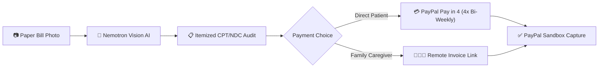

# 🛡️ PainFree CarePay AI
> **Surprise Medical Bill Vision Intelligence with PayPal Pay in 4 & Family Caregiver Checkout**  
> *Devpost Official Submission for the PayPal AI Hackathon 2026*

---

## 📌 Executive Summary
In the United States, over **100 million Americans struggle with medical debt**, burdened by opaque hospital billing, unexpected out-of-network charges, and dense CPT/NDC medical jargon. Furthermore, over **53 million family caregivers** coordinate care for aging parents but lack a frictionless bridge to review bills and pay remotely.

**PainFree CarePay AI** bridges medical vision intelligence directly with **PayPal's financial ecosystem**:
1. **Snap & Audit**: Patients photograph any US hospital bill or prescription receipt.
2. **AI Protection**: Vision AI instantly translates cryptic CPT codes, validates insurance co-pays, and flags potential surprise out-of-network charges.
3. **Frictionless Payment**: Patients can either split the remaining responsibility into **4 interest-free PayPal payments (Pay in 4)** or dispatch a **Family Caregiver Payment Link** so adult children can review and pay remotely in seconds.

---

## 🚀 Key Features

### 1. Vision AI Medical Bill Deconstruction
- **NVIDIA Nemotron-3.5-Super-VL & 550B MoE Reasoning**: Reads complex tables, CPT procedure codes, NDC drug codes, and fee breakdowns from raw camera photos.
- **Surprise Bill Guardrails**: Cross-checks billed amounts against regional median in-network benchmarks (aligning with the US *No Surprises Act*).

### 2. PayPal Pay in 4 Financing
- Automatic installment scheduling: Splits heavy bills into 4 bi-weekly, interest-free payments (e.g., $180 total bill &rarr; 4 payments of $45 every two weeks).
- Zero credit score impact, clear timeline visualization, and one-click authorization via PayPal Sandbox.

### 3. Family Caregiver Payment Portal (Remote Care)
- Generates a secure, itemized web invoice link that aging patients can send to adult children or guardians via SMS or email.
- The caregiver sees the exact breakdown, AI audit notes, and pays directly via PayPal without needing the physical paper bill.

---

## 🏗️ Architecture & Pipeline



---

## 💻 Tech Stack
- **Frontend**: Clean Vanilla HTML5 / CSS3 / JavaScript (Zero-bloat, high-performance responsive UI).
- **Backend**: Python 3.10 HTTP Microservice (`app.py`), JSON REST API.
- **AI Vision Pipeline**: NVIDIA Nemotron-3.5-Super-VL / Qwen multimodal fallback (`receipt_pipeline.py`).
- **Payments**: PayPal Developer Sandbox, Smart Payment Buttons, Orders v2 API.

---

## 🏃 Quick Start (Local Run)

### 1. Requirements
- Python 3.10+
- Internet connection (for PayPal SDK and optional Nebius Vision API)

### 2. Run with One-Click
Double-click `run_carepay.bat` or run:
```bash
python app.py
```
Open your browser at:
```
http://127.0.0.1:8050
```

---

## 📜 License
MIT License. Created by Hwan (Synapse Creative / PainFree Team) for the PayPal AI Hackathon 2026.
